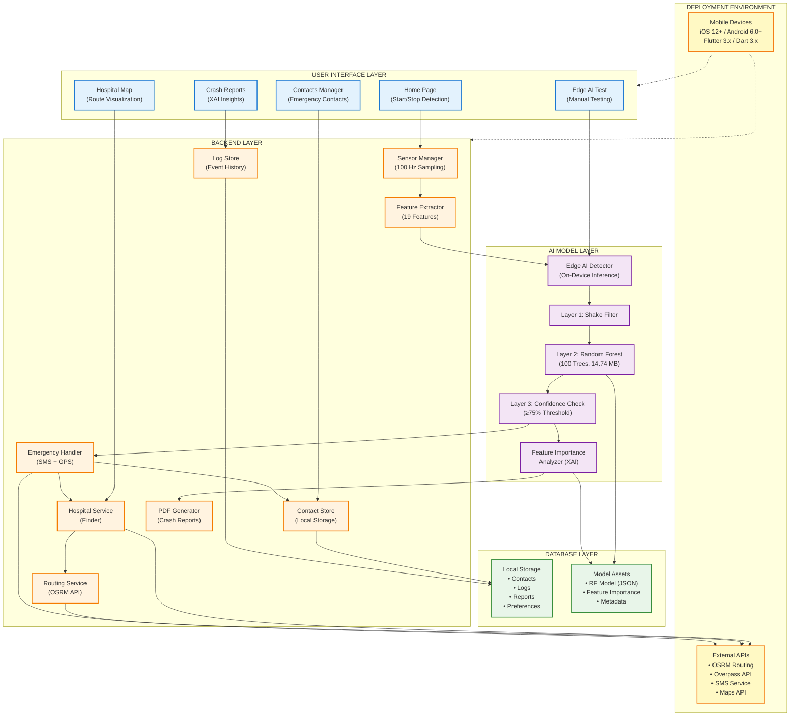

# System Architecture - Block Diagram

## Visual Block Diagram



---

## Layer Descriptions

### 🔵 **User Interface Layer**
- **Home Page**: Main interface for starting/stopping accident detection
- **Contacts Manager**: Configure emergency contacts for SMS alerts
- **Crash Reports**: View past accidents with XAI explanations
- **Hospital Map**: Visualize nearby hospitals and routes
- **Edge AI Test**: Manual testing interface for developers

### 🟠 **Backend Layer**
- **Sensor Manager**: Collects accelerometer, gyroscope, GPS data at 100 Hz
- **Feature Extractor**: Generates 19 ML features from 2-second sliding windows
- **Emergency Handler**: Dispatches SMS alerts with GPS coordinates
- **Contact Store**: Manages emergency contact information locally
- **Hospital Service**: Finds nearby hospitals using Overpass API
- **Routing Service**: Calculates optimal routes using OSRM API
- **PDF Generator**: Creates crash reports with XAI insights
- **Log Store**: Maintains event history and false alarm logs

### 🟣 **AI Model Layer**
- **Edge AI Detector**: Main orchestrator for on-device ML inference
- **Layer 1 - Shake Filter**: Quick pattern-based pre-filter
- **Layer 2 - Random Forest**: 100-tree classifier (14.74 MB model)
- **Layer 3 - Confidence Check**: Validates predictions with ≥75% threshold
- **Feature Importance Analyzer**: Generates XAI explanations

### 🟢 **Database Layer**
- **Local Storage**: Contacts, logs, reports, user preferences (Hive/SharedPreferences)
- **Model Assets**: RF model JSON, feature importance CSV, metadata

### 🟡 **Deployment Environment**
- **Mobile Devices**: iOS 12+, Android 6.0+, Flutter 3.x, Dart 3.x
- **External APIs**: OSRM routing, Overpass hospital data, SMS service, Maps API

---

## Data Flow

```
Sensors (100Hz) → Feature Extraction (19 features) → 3-Layer Detection 
    → Decision (REAL/FAKE) → Emergency Response (SMS + Routing)
```

---

## Export Options

To export this diagram as an image:
1. **Online**: Visit https://mermaid.live/ and paste the code above
2. **VS Code**: Use "Markdown Preview Mermaid Support" extension
3. **CLI**: Use `mmdc -i BLOCK_DIAGRAM.md -o block_diagram.png` (requires mermaid-cli)
