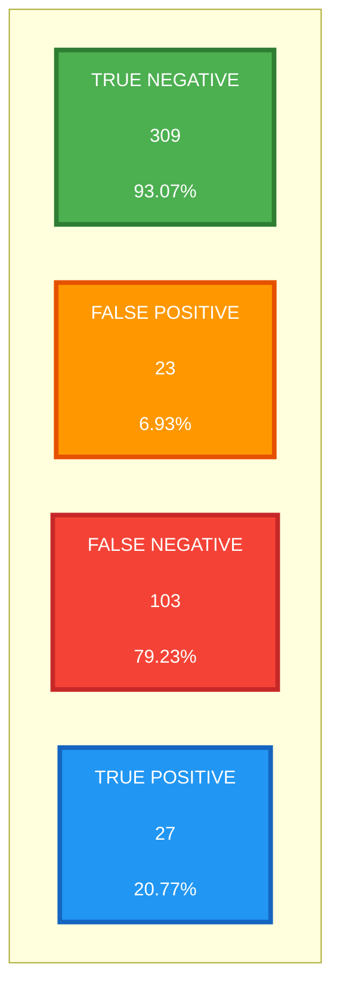
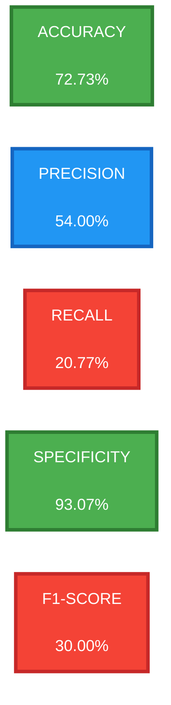
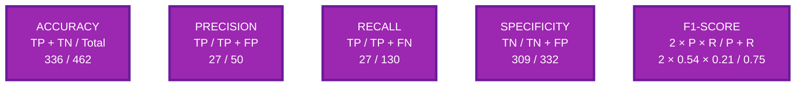

# Model Performance Metrics Visualization

## 📊 Diagram 1: Simple Confusion Matrix



**Legend:**
- 🟢 **Green**: Correctly identified FAKE (True Negative)
- 🔵 **Blue**: Correctly identified REAL (True Positive)
- 🟠 **Orange**: FAKE predicted as REAL (False Positive)
- 🔴 **Red**: REAL predicted as FAKE (False Negative)

---

## 📈 Diagram 2: Performance Metrics



**Performance Rating:**
- 🟢 **Green**: Good performance (>70%)
- 🔴 **Red**: Needs improvement (<40%)
- 🔵 **Blue**: Moderate performance (40-70%)

---

## 📊 Diagram 3: Metric Formulas



**Color Legend:**
- 🟢 **Green (TN)**: True Negatives - Correctly identified false alarms
- 🔵 **Blue (TP)**: True Positives - Correctly identified real accidents
- 🟠 **Orange (FP)**: False Positives - Incorrectly flagged as accidents
- 🔴 **Red (FN)**: False Negatives - Missed real accidents

---

## � Confusion Matrix Table

|  | **Predicted FAKE** | **Predicted REAL** | **Total** |
|---|---|---|---|
| **Actual FAKE** | 309 (TN) ✓ | 23 (FP) ✗ | 332 |
| **Actual REAL** | 103 (FN) ✗ | 27 (TP) ✓ | 130 |
| **Total** | 412 | 50 | **462** |

---

## 📊 Summary Table

| Metric | Value | Formula | Meaning |
|--------|-------|---------|---------|
| **Accuracy** | 72.73% | (TP+TN) / Total | Overall correctness |
| **Precision** | 54.00% | TP / (TP+FP) | Accuracy of REAL predictions |
| **Recall** | 20.77% | TP / (TP+FN) | Detection rate of actual accidents |
| **Specificity** | 93.07% | TN / (TN+FP) | False alarm prevention rate |
| **F1-Score** | 30.00% | 2×(P×R) / (P+R) | Harmonic mean of P & R |

Where:
- **TP** (True Positive) = 27
- **TN** (True Negative) = 309
- **FP** (False Positive) = 23
- **FN** (False Negative) = 103

---

## 🎯 Key Insights

✅ **Strengths:**
- High specificity (93.07%) - Excellent false alarm prevention
- Good accuracy (72.73%) - Reliable overall performance
- Low false positive rate (6.93%) - Minimal unnecessary alerts

⚠️ **Weaknesses:**
- Low recall (20.77%) - Misses many real accidents
- Low F1-score (30%) - Imbalance between precision and recall
- High false negative rate (79.23%) - Conservative detection

**Design Philosophy:** The model prioritizes **user trust** (low false alarms) over **maximum sensitivity** (high recall). This is appropriate for a safety-critical app where frequent false alarms would lead users to disable the feature.

---

## 📥 How to Export as Image

**Option 1 - Online (Recommended):**
1. Visit https://mermaid.live/
2. Copy any diagram code from above
3. Paste it into the editor
4. Click "Download PNG" or "Download SVG"

**Option 2 - VS Code:**
1. Install "Markdown Preview Mermaid Support" extension
2. Open this file and click "Open Preview"
3. Right-click the diagram to save as image

**Option 3 - Command Line:**
```bash
npm install -g @mermaid-js/mermaid-cli
mmdc -i MODEL_METRICS_VISUALIZATION.md -o metrics.png
```

The diagrams are now **simplified and readable** with larger fonts and clearer layouts!
