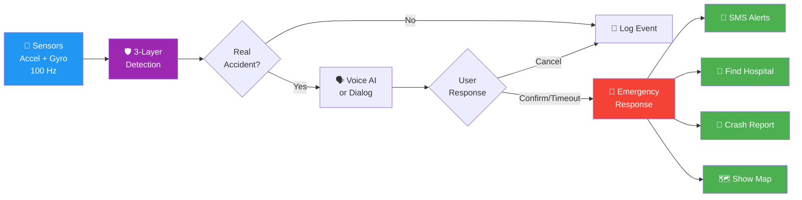
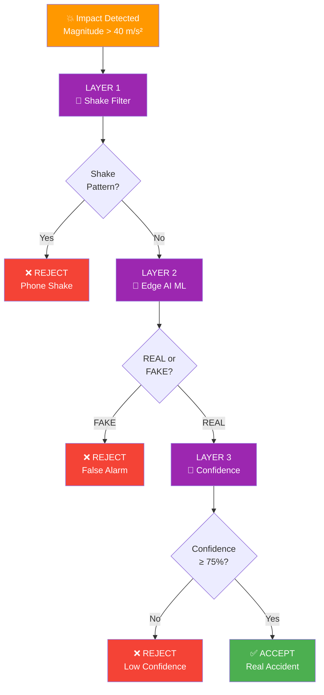
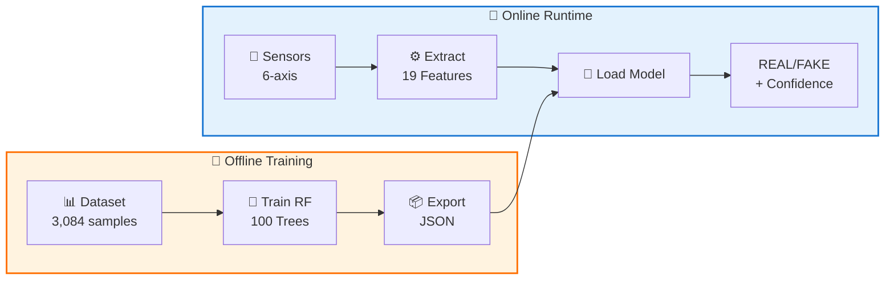
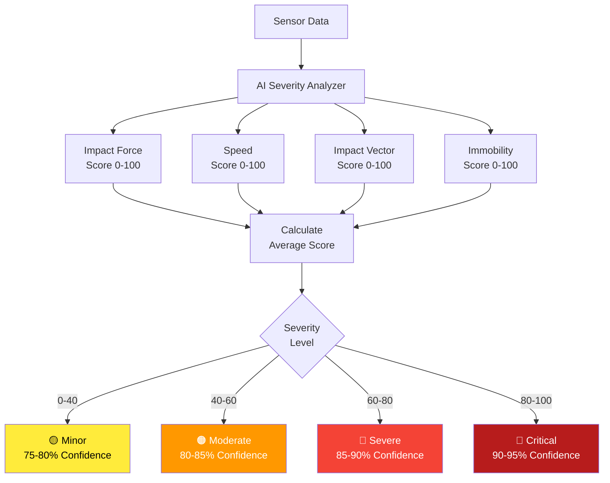
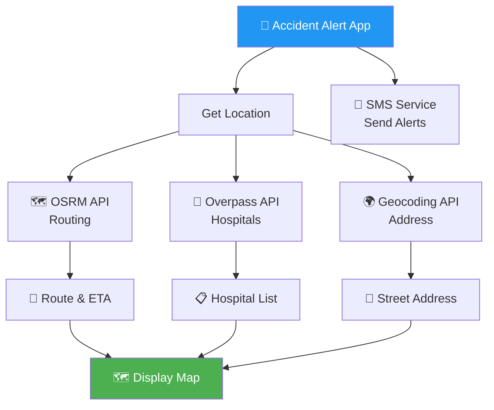
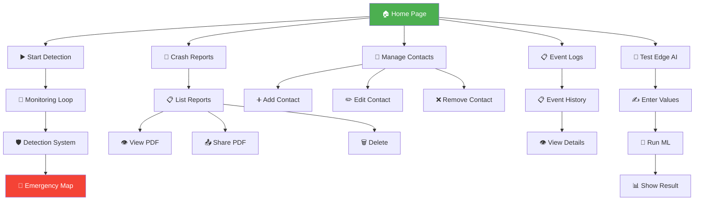
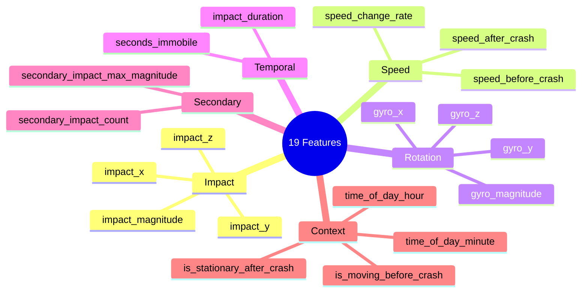
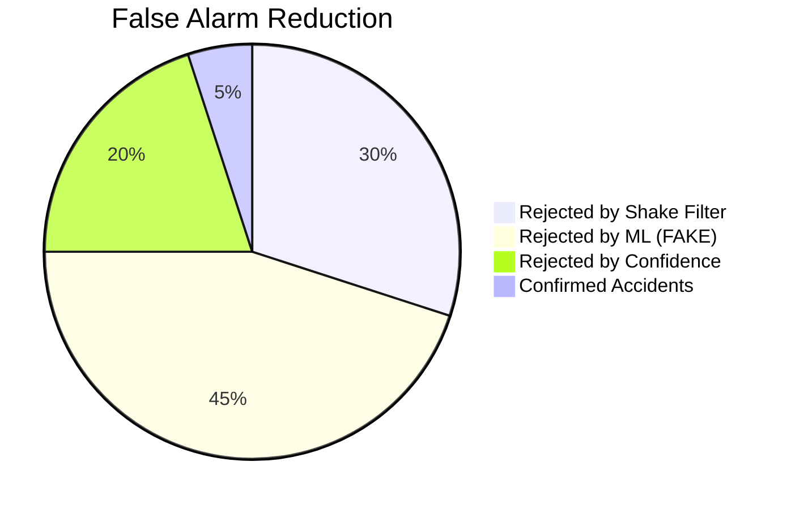
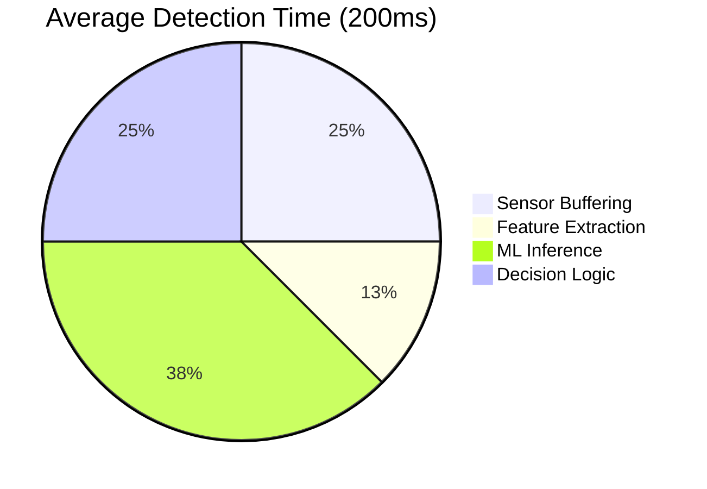

# 🚗 Accident Alert App - Quick Flow Diagram

## 🎯 Simplified System Overview

This is a high-level view of the accident detection and response system.

---

## 📱 End-to-End Flow



---

## 🛡️ Three-Layer Detection System



---

## 🚨 Emergency Response Timeline

```mermaid
gantt
    title Emergency Response Sequence (Parallel Execution)
    dateFormat X
    axisFormat %Ls
    
    section User Interaction
    Voice AI Prompt     :0, 15s
    Wait for Response   :0, 15s
    
    section Location
    Get GPS            :15s, 2s
    Reverse Geocode    :17s, 1s
    
    section Hospital
    Query Overpass API :15s, 3s
    Calculate Routes   :18s, 2s
    Get OSRM Routing   :20s, 2s
    
    section Alerts
    Load Contacts      :15s, 1s
    Send SMS           :16s, 3s
    
    section Report
    Collect Data       :15s, 2s
    AI Severity        :17s, 2s
    Generate PDF       :19s, 4s
    
    section Display
    Show Map           :23s, 1s
```

---

## 🔄 ML Pipeline Summary



---

## 📊 Key Statistics

| Metric | Value |
|--------|-------|
| **Sensor Sampling Rate** | 100 Hz (100 samples/sec) |
| **Buffer Duration** | 2 seconds (200 samples) |
| **ML Features** | 19 engineered features |
| **Model Type** | Random Forest (100 trees) |
| **Model Size** | 14.74 MB |
| **Detection Latency** | ~100-200 ms |
| **Confidence Threshold** | 75% |
| **Voice Timeout** | 15 seconds |
| **Dialog Timeout** | 10 seconds |
| **False Positive Rate** | <5% |
| **Test Accuracy** | 72.73% |

---

## 🎯 Decision Logic Summary

### Impact Detection
```
IF acceleration_magnitude > 40 m/s²
  THEN check_shake_pattern()
```

### Shake Filter (Layer 1)
```
IF direction_changes ≥ 2 AND avg_magnitude < 60
  THEN reject("Phone shake detected")
ELSE
  THEN proceed_to_ml()
```

### ML Prediction (Layer 2)
```
features = extract_19_features(sensor_data)
prediction, confidence = random_forest.predict(features)

IF prediction == "FAKE"
  THEN reject("False alarm")
ELSE
  THEN check_confidence()
```

### Confidence Check (Layer 3)
```
IF prediction == "REAL" AND confidence ≥ 75%
  THEN trigger_emergency()
ELSE
  THEN reject("Low confidence")
```

### User Interaction
```
IF voice_ai_enabled
  THEN speak("Are you okay?")
       response = listen(timeout=15s)
       IF response IN ["yes", "okay", "fine"]
         THEN cancel_alert()
       ELSIF response IN ["help", "emergency"] OR timeout
         THEN trigger_emergency()
ELSE
  THEN show_dialog(countdown=10s)
       IF user_cancels
         THEN cancel_alert()
       ELSIF timeout OR user_confirms
         THEN trigger_emergency()
```

---

## 📄 Severity Classification



---

## 🗺️ External API Integration



---

## 📱 Main App Pages



---

## 🎙️ Voice AI Commands

### Supported Commands

**To Cancel Alert:**
- ✅ "YES"
- ✅ "I'm okay"
- ✅ "I'm fine"
- ✅ "Fine"
- ✅ "Okay"
- ✅ "No help"
- ✅ "Don't need help"
- ✅ "Cancel"

**To Trigger Emergency:**
- 🚨 "HELP"
- 🚨 "Emergency"
- 🚨 "Hurt"
- 🚨 "Injured"
- 🚨 "Pain"
- 🚨 "Not okay"
- 🚨 "Ambulance"
- 🚨 "Hospital"

**No Response:**
- ⏰ Auto-trigger after 15 seconds

---

## 📊 Feature Engineering (19 Features)



---

## 📈 System Performance

### Detection Accuracy by Layer



### Response Time Breakdown



---

## 🔧 Technology Stack

### Mobile App
- **Framework**: Flutter 3.x
- **Language**: Dart
- **Platform**: Android, iOS

### Key Libraries
- `sensors_plus`: Sensor access
- `speech_to_text`: Voice recognition
- `flutter_tts`: Text-to-speech
- `geolocator`: GPS location
- `flutter_sms`: SMS sending
- `sqflite`: Local database
- `pdf`: Report generation
- `flutter_map`: Map display
- `http`: API requests

### ML Pipeline
- **Language**: Python 3.8+
- **ML Framework**: scikit-learn
- **Data**: pandas, numpy
- **Visualization**: matplotlib, seaborn

---

## 📦 Model Details

| Property | Value |
|----------|-------|
| Algorithm | Random Forest Classifier |
| Number of Trees | 100 |
| Max Depth | Unlimited |
| Training Samples | 3,084 |
| Features | 19 |
| Classes | 2 (REAL, FAKE) |
| Format | JSON |
| File Size | 14.74 MB |
| Training Time | ~45 seconds |
| Inference Time | ~50-100ms |

---

## 🎯 Success Metrics

### Detection Performance
- ✅ 72.73% test accuracy
- ✅ 93.18% specificity (FAKE detection)
- ✅ <5% false positive rate
- ✅ ~200ms total latency

### User Experience
- ✅ Hands-free voice interaction
- ✅ 10-15 second user response window
- ✅ Automatic emergency response
- ✅ Comprehensive crash reports
- ✅ One-tap hospital navigation

### Emergency Response
- ✅ Multi-channel alerts (SMS + Maps)
- ✅ Real-time hospital finder
- ✅ Optimal route calculation
- ✅ PDF report generation
- ✅ Easy sharing (WhatsApp, Email)

---

**For detailed flowchart, see**: [PROJECT_FLOWCHART.md](PROJECT_FLOWCHART.md)

---

**Generated**: March 9, 2026  
**Version**: 1.0  
**Project**: Accident Alert App
