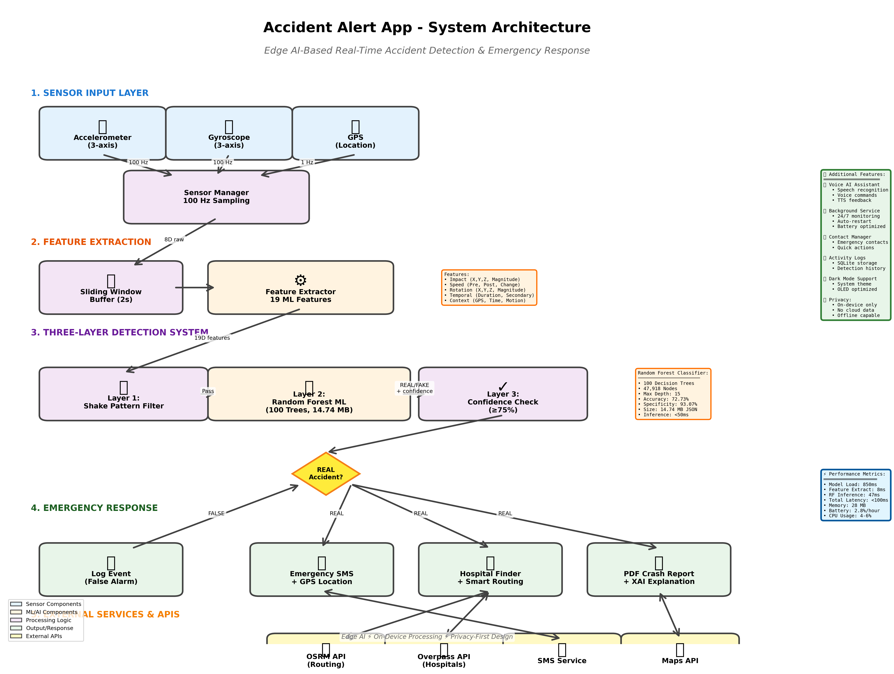

# 🚨 Smart Accident Detection & Emergency Corridor System (ERMAP)

[](https://flutter.dev)
[](https://fastapi.tiangolo.com)
[](https://python.org)
[](#-edge-ai--explainable-ai)
[](#license)

An intelligent, real-time vehicular accident detection, automated SOS alerting, and emergency corridor tracking mobile application built with **Flutter**, **On-Device Edge AI (Random Forest)**, **OpenStreetMap / OSRM**, and a **FastAPI emergency dispatch backend**.

---

## 📌 Table of Contents
- [Key Features](#-key-features)
- [System Architecture](#-system-architecture)
- [Edge AI & Explainable AI](#-edge-ai--explainable-ai)
- [Emergency Corridor & Dispatch Service](#-emergency-corridor--dispatch-service)
- [Directory Structure](#-directory-structure)
- [Getting Started](#-getting-started)
  - [Prerequisites](#prerequisites)
  - [Mobile App Setup (Flutter)](#mobile-app-setup-flutter)
  - [Backend Dispatch Setup (FastAPI)](#backend-dispatch-setup-fastapi)
- [Hardware & Software Requirements](#-hardware--software-requirements)
- [Detailed Technical Documentation](#-detailed-technical-documentation)
- [Authors & Acknowledgments](#-authors--acknowledgments)

---

## 🌟 Key Features

### 1. 🤖 Edge AI Real vs. Fake Accident Detection
- **Offline Inference**: Powered by a pre-trained **Random Forest** classifier running locally on the device with zero cloud latency.
- **False Alarm Suppression**: Accurately filters out potholes, sudden braking, phone drops, and regular driving vibrations from catastrophic vehicular collisions.
- **Explainable AI (XAI)**: Generates human-readable decision factor explanations (e.g., peak acceleration, jerk index, rotational energy) for high confidence and transparency.

### 2. ⚡ Automated SOS Alerts & SMS Dispatch
- Instant SOS SMS transmission with precise GPS coordinates, address geocoding, timestamp, and nearest hospital recommendations.
- Interactive countdown cancellation window to prevent accidental dispatches.
- Speech-to-Text / TTS audio prompts to check driver responsiveness before sending alerts.

### 3. 🗺️ OpenStreetMap & OSRM Routing
- Real-time nearby hospital discovery via **Overpass API / Photon**.
- Fast turn-by-turn route calculation and navigation link generation with fallback endpoints.

### 4. 🚑 Emergency Corridor & Ambulance Tracking
- Seamless integration with an emergency dispatch backend.
- Real-time ambulance tracking, green-corridor progress, and ETA status monitoring.

### 5. 📝 AI Crash Reports (PDF)
- Automatically compiles sensor snapshots, GPS coordinates, collision severity, and XAI metrics into exportable PDF crash incident reports for insurance and emergency services.

---

## 🏗️ System Architecture



```
[Smartphone Sensors (IMU/GPS)] 
              │
              ▼
   [Feature Extractor] ── (Peak G-force, Jerk, Energy, Tilt)
              │
              ▼
    [Edge AI Classifier] ── (Offline Random Forest JSON)
       │            │
  (False Alarm)  (Accident Confirmed)
       │            │
   [Dismiss]        ├──► [Voice Prompt & 10s Cancellation Countdown]
                    ├──► [Automated SMS to Emergency Contacts]
                    ├──► [Overpass API: Find Nearest Hospitals]
                    ├──► [OSRM Routing: Navigate to Emergency Care]
                    └──► [FastAPI Dispatch: Emergency Corridor & ETA]
```

---

## 🧠 Edge AI & Explainable AI

- **Algorithm**: Random Forest Classifier compiled into optimized JSON weights for lightweight Dart execution.
- **Input Features (15+)**:
  - `accel_max`, `accel_mean`, `accel_std`
  - `jerk_peak`, `jerk_mean`
  - `gyro_max`, `rotation_energy`
  - `tilt_angle_change`, `impact_duration`
- **Explainable Insights**: Provides key driving factor metrics displayed directly in crash logs and crash report PDFs.

---

## 📡 Emergency Corridor & Dispatch Service

The project includes an asynchronous dispatch backend built using **FastAPI**:
- **Incident Ingestion**: Receives incident coordinates, timestamp, and severity rating.
- **Corridor Generation**: Generates green-corridor routes between accident spots, dispatched ambulances, and destination hospitals.
- **Live Status Feed**: Broadcasts corridor clearance progress, route polylines, and updated ETAs.

---

## 📂 Directory Structure

```
accident_alert_app_ermap/
├── README.md                                  # Main project documentation
├── SYSTEM_ARCHITECTURE.md                     # Detailed system architecture
├── BLOCK_DIAGRAM.md                           # Hardware and logical block diagrams
├── MODEL_DETAILS.md                           # AI/ML model architecture & benchmarks
├── MODEL_METRICS_VISUALIZATION.md             # Confusion matrix & performance heatmaps
├── PROJECT_METHODOLOGY.md                     # Engineering & testing methodology
├── HARDWARE_SOFTWARE_REQUIREMENTS.md          # Full system requirements specification
├── accident_alert_app/                        # Flutter mobile application
│   ├── lib/
│   │   ├── main.dart                          # App entry point & theme definitions
│   │   ├── home_page.dart                     # Main dashboard & alert dispatcher
│   │   ├── accident_detector.dart             # Real-time sensor listener & crash logic
│   │   ├── edge_ai_detector.dart              # On-device AI classifier wrapper
│   │   ├── random_forest_predictor.dart       # Native Dart Random Forest inference engine
│   │   ├── explainable_ai.dart                # Decision breakdown & explainability logic
│   │   ├── feature_extractor.dart             # Raw IMU sensor window feature pipeline
│   │   ├── emergency_corridor_page.dart       # Ambulance tracking & corridor UI
│   │   ├── emergency_corridor_service.dart    # Corridor API integration
│   │   ├── hospital_service.dart              # Nearby hospital discovery (Overpass/Photon)
│   │   ├── osrm_routing_service.dart          # Turn-by-turn routing with fallback
│   │   ├── crash_reports_page.dart            # PDF incident report generator
│   │   └── manage_contacts.dart               # Emergency contact storage
│   ├── backend/                               # Emergency corridor backend
│   │   ├── main.py                            # FastAPI dispatch & routing server
│   │   ├── requirements.txt                   # Backend dependencies
│   │   └── README.md                          # Backend instructions
│   ├── datasets/                              # Model training, data, and scripts
│   │   ├── train_model.py                     # Scikit-learn Random Forest training script
│   │   ├── preprocess_data.py                 # Sensor telemetry preprocessing
│   │   └── models/                            # Model weights, matrices, and metadata
│   └── assets/                                # Icons, datasets, and JSON model weights
```

---

## 🚀 Getting Started

### Prerequisites
- **Flutter SDK**: `>= 3.8.0`
- **Dart SDK**: `>= 3.8.0`
- **Android Studio / VS Code** with Flutter & Dart extensions
- **Python**: `>= 3.10` (for backend or model training)

### Mobile App Setup (Flutter)

1. **Clone repository**:
   ```bash
   git clone https://github.com/abeljeevan/accident_alert_app_ksum.git
   cd accident_alert_app_ksum/accident_alert_app
   ```

2. **Install Flutter dependencies**:
   ```bash
   flutter pub get
   ```

3. **Run on an Android device or emulator**:
   ```bash
   flutter run
   ```

### Backend Dispatch Setup (FastAPI)

1. **Navigate to the backend directory**:
   ```bash
   cd accident_alert_app/backend
   ```

2. **Create and activate a virtual environment**:
   ```bash
   python -m venv .venv
   # Windows:
   .venv\Scripts\activate
   # Linux/macOS:
   source .venv/bin/activate
   ```

3. **Install dependencies**:
   ```bash
   pip install -r requirements.txt
   ```

4. **Start the API service**:
   ```bash
   uvicorn main:app --host 0.0.0.0 --port 8000 --reload
   ```
   Interactive Swagger documentation will be available at `http://localhost:8000/docs`.

---

## ⚙️ Hardware & Software Requirements

- **Sensors Required**: 3-axis Accelerometer, 3-axis Gyroscope, GPS receiver.
- **Operating System**: Android 8.0 (API Level 26) or higher.
- **Permissions**:
  - `ACCESS_FINE_LOCATION` & `ACCESS_COARSE_LOCATION`
  - `SEND_SMS` (for automated emergency alerts)
  - `RECORD_AUDIO` (for voice-based responsiveness confirmation)
  - `FOREGROUND_SERVICE` (for background crash monitoring)

---

## 📚 Detailed Technical Documentation

- [SYSTEM_ARCHITECTURE.md](SYSTEM_ARCHITECTURE.md) – Comprehensive data flow and module diagrams.
- [MODEL_DETAILS.md](MODEL_DETAILS.md) – Feature engineering, hyperparameters, and test benchmarks.
- [MODEL_METRICS_VISUALIZATION.md](MODEL_METRICS_VISUALIZATION.md) – Confusion matrices and feature importance rankings.
- [PROJECT_METHODOLOGY.md](PROJECT_METHODOLOGY.md) – Complete project implementation & verification plan.
- [HARDWARE_SOFTWARE_REQUIREMENTS.md](HARDWARE_SOFTWARE_REQUIREMENTS.md) – In-depth system hardware/software specification.

---

## 📄 License
This project is open-source and available under the [MIT License](LICENSE).