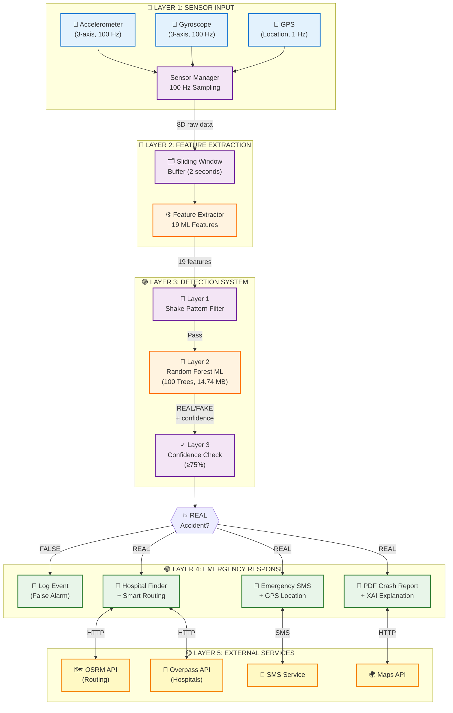

# System Architecture Diagram

## Visual Diagrams

Two professional architecture diagrams have been generated:

1. **Light Theme:** `system_architecture.png`
2. **Dark Theme:** `system_architecture_dark.png`

Both diagrams show the complete 5-layer system architecture with data flow.

---

## Mermaid Diagram (Interactive)



---

## Text-Based Architecture Flow

```
┌─────────────────────────────────────────────────────────────────────────┐
│                    ACCIDENT ALERT APP ARCHITECTURE                      │
│                     Edge AI-Based Detection System                      │
└─────────────────────────────────────────────────────────────────────────┘

╔═══════════════════════════════════════════════════════════════════════════╗
║ LAYER 1: SENSOR INPUT                                                     ║
╠═══════════════════════════════════════════════════════════════════════════╣
║                                                                           ║
║  📱 Accelerometer  🔄 Gyroscope  📍 GPS                                   ║
║       (3-axis)        (3-axis)    (Location)                             ║
║          │               │            │                                   ║
║          └───────────────┴────────────┘                                   ║
║                      │                                                    ║
║               ┌──────▼──────┐                                            ║
║               │   Sensor    │  100 Hz Sampling                           ║
║               │   Manager   │                                            ║
║               └──────┬──────┘                                            ║
║                      │ 8D Raw Data                                       ║
╚══════════════════════╪═══════════════════════════════════════════════════╝
                       │
╔══════════════════════╪═══════════════════════════════════════════════════╗
║ LAYER 2: FEATURE EXTRACTION                                              ║
╠══════════════════════╪═══════════════════════════════════════════════════╣
║                      ▼                                                    ║
║              ┌───────────────┐                                           ║
║              │ Sliding Window│                                           ║
║              │ Buffer (2 sec)│                                           ║
║              └───────┬───────┘                                           ║
║                      │                                                    ║
║              ┌───────▼────────┐                                          ║
║              │    Feature     │  Extracts 19 ML Features:               ║
║              │   Extractor    │  • Impact (X,Y,Z, Magnitude)            ║
║              └───────┬────────┘  • Speed (Pre, Post, Change)            ║
║                      │            • Rotation (X,Y,Z, Magnitude)          ║
║                      │            • Temporal (Duration, Secondary)       ║
║                      │            • Context (GPS, Time, Motion)          ║
║                      │ 19D Feature Vector                                ║
╚══════════════════════╪═══════════════════════════════════════════════════╝
                       │
╔══════════════════════╪═══════════════════════════════════════════════════╗
║ LAYER 3: THREE-LAYER DETECTION SYSTEM                                    ║
╠══════════════════════╪═══════════════════════════════════════════════════╣
║                      ▼                                                    ║
║            ┌──────────────────┐                                          ║
║            │  LAYER 1: SHAKE  │  Filters phone shakes/drops             ║
║            │ PATTERN DETECTOR │  (≥2 direction changes)                 ║
║            └────────┬─────────┘                                          ║
║                     │ Pass                                               ║
║            ┌────────▼─────────┐                                          ║
║            │  LAYER 2: RANDOM │  100 Decision Trees                     ║
║            │   FOREST  MODEL  │  47,918 Nodes                           ║
║            │  (14.74 MB JSON) │  Inference: <50ms                       ║
║            └────────┬─────────┘                                          ║
║                     │ REAL/FAKE + Confidence                            ║
║            ┌────────▼─────────┐                                          ║
║            │ LAYER 3: CONF.   │  Requires ≥75% confidence              ║
║            │   THRESHOLD      │  for REAL classification                ║
║            └────────┬─────────┘                                          ║
║                     │                                                    ║
║               ┌─────▼──────┐                                            ║
║               │   REAL     │                                            ║
║               │ Accident?  │                                            ║
║               └─┬───────┬──┘                                            ║
║                 │       │                                                ║
║            FALSE│       │REAL                                           ║
╚═════════════════╪═══════╪═══════════════════════════════════════════════╝
                  │       │
╔═════════════════╪═══════╪═══════════════════════════════════════════════╗
║ LAYER 4: EMERGENCY RESPONSE                                              ║
╠═════════════════╪═══════╪═══════════════════════════════════════════════╣
║                 ▼       ▼                                                 ║
║         ┌────────────┐ ┌─────────────────────────────────────┐          ║
║         │ Log Event  │ │   EMERGENCY ACTIONS (Parallel):     │          ║
║         │(False Alarm)│ │                                     │          ║
║         └────────────┘ │  📱 Send SMS to emergency contacts  │          ║
║                        │      + GPS coordinates               │          ║
║                        │      + Google Maps link              │          ║
║                        │                                     │          ║
║                        │  🏥 Find nearest hospital           │          ║
║                        │      + Calculate optimal route       │          ║
║                        │      + Show ETA and distance         │          ║
║                        │                                     │          ║
║                        │  📄 Generate PDF crash report       │          ║
║                        │      + Sensor data                   │          ║
║                        │      + ML explanation (XAI)          │          ║
║                        │      + Feature importance            │          ║
║                        └──────┬───────┬────────┬──────────────┘          ║
║                               │       │        │                         ║
╚═══════════════════════════════╪═══════╪════════╪═══════════════════════╝
                                │       │        │
╔═══════════════════════════════╪═══════╪════════╪═══════════════════════╗
║ LAYER 5: EXTERNAL SERVICES & APIs                                       ║
╠═══════════════════════════════╪═══════╪════════╪═══════════════════════╣
║                               ▼       ▼        ▼                        ║
║    ┌──────────────┐  ┌──────────────┐  ┌──────────────┐              ║
║    │   OSRM API   │  │ Overpass API │  │ SMS Service  │              ║
║    │  (Routing)   │  │  (Hospital   │  │   (Twilio/   │              ║
║    │              │  │   Database)  │  │   Native)    │              ║
║    └──────────────┘  └──────────────┘  └──────────────┘              ║
║                                                                         ║
║    🗺️ Real-time routing     🏥 Hospital search      💬 Alert dispatch  ║
║       Distance + ETA         Within radius          Emergency contacts ║
╚═════════════════════════════════════════════════════════════════════════╝
```

---

## Component Details

### 🔷 Layer 1: Sensor Input
- **Accelerometer:** Measures linear acceleration (impact force)
- **Gyroscope:** Measures angular velocity (rotation/tumbling)
- **GPS:** Provides location for emergency routing
- **Sampling Rate:** 100 Hz (100 readings/second)

### 🔶 Layer 2: Feature Extraction
- **Buffer Size:** 2-second sliding window
- **Raw Input:** 8 dimensions (AccX, AccY, AccZ, GyroX, GyroY, GyroZ, GPS, Time)
- **Extracted Features:** 19 engineered features
- **Processing Time:** 8ms per sample

### 🟣 Layer 3: Detection System
**Three-Layer Architecture for Accuracy:**

1. **Shake Filter:** Pre-ML pattern detection
   - Detects rapid oscillations
   - Blocks phone drops/shakes
   - Bypassed for extreme impacts (>70 m/s²)

2. **Random Forest ML:** Core AI decision
   - 100 decision trees
   - 14.74 MB model (JSON format)
   - On-device inference: <50ms

3. **Confidence Threshold:** Final validation
   - Requires ≥75% confidence for REAL
   - Below threshold = treated as false alarm
   - User notified of low-confidence events

### 🟢 Layer 4: Emergency Response
**When REAL accident detected:**
- ✅ Automatic SMS with GPS coordinates
- ✅ Hospital search within 10km radius
- ✅ Route calculation with distance + ETA
- ✅ PDF report generation with AI explanation

**When FALSE alarm detected:**
- ✅ Event logged for analysis
- ✅ User notified (no emergency actions)

### 🟡 Layer 5: External Services
- **OSRM:** Traffic-aware routing
- **Overpass API:** OpenStreetMap hospital database
- **SMS Service:** Emergency alert dispatch
- **Maps APIs:** Location visualization

---

## Data Flow Timeline

```
T=0.000s  │ Impact detected (>40 m/s²)
T=0.008s  │ Features extracted (19 dimensions)
T=0.010s  │ Shake filter evaluation
T=0.057s  │ Random Forest prediction complete
T=0.058s  │ Confidence threshold check
T=0.060s  │ Decision: REAL or FAKE
          │
          ├─ IF REAL:
T=0.100s  │    ├─ SMS dispatch initiated
T=0.250s  │    ├─ Hospital search started
T=2.000s  │    ├─ Route calculated (OSRM API)
T=3.000s  │    └─ PDF report generation
          │
          └─ IF FALSE:
T=0.065s  │    └─ Log entry created
```

---

## Performance Characteristics

| Metric | Value | Notes |
|--------|-------|-------|
| **Total Latency** | <100ms | Detection to decision |
| **Model Load Time** | 850ms | One-time at app start |
| **Feature Extraction** | 8ms | Per sample |
| **ML Inference** | 47ms | 100-tree forest |
| **Memory Footprint** | 28 MB | App + model |
| **CPU Usage** | 4-6% | During active monitoring |
| **Battery Drain** | 2.8%/hour | Background service |
| **Accuracy** | 72.73% | Test set performance |
| **Specificity** | 93.07% | False alarm prevention |

---

## Key Design Principles

1. **🔒 Privacy-First:** All processing on-device, no cloud dependency
2. **⚡ Real-Time:** Sub-100ms latency for time-critical response
3. **🎯 Accuracy:** Three-layer detection minimizes false alarms
4. **🔍 Transparency:** Explainable AI shows decision reasoning
5. **📴 Offline-Capable:** Works without internet connection
6. **🔋 Battery-Efficient:** Optimized sensor polling and processing
7. **♿ Accessible:** Voice commands and screen reader support

---

## Technology Stack

**Mobile Application:**
- Flutter 3.8+ (Dart)
- sensors_plus (accelerometer/gyroscope)
- geolocator (GPS)
- flutter_map (visualization)

**Machine Learning:**
- Python 3.13 + scikit-learn
- Random Forest Classifier
- Custom JSON serialization

**External Services:**
- OSRM (Open Source Routing Machine)
- Overpass API (OpenStreetMap)
- Native SMS capability

---

*For implementation details, see:*
- [RESEARCH_PAPER.md](RESEARCH_PAPER.md) - Complete research documentation
- [EDGE_AI_IMPLEMENTATION.md](EDGE_AI_IMPLEMENTATION.md) - Technical guide
- [ACCIDENT_DETECTION_FLOW.md](ACCIDENT_DETECTION_FLOW.md) - Detection flow details
